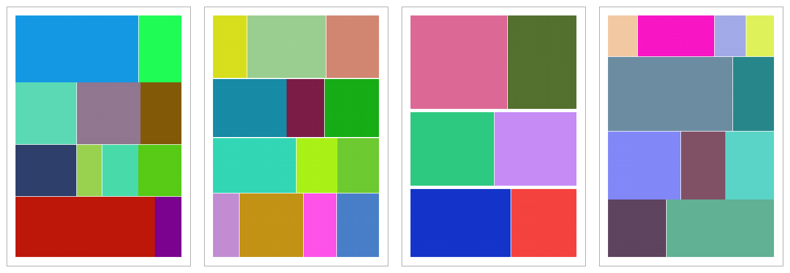
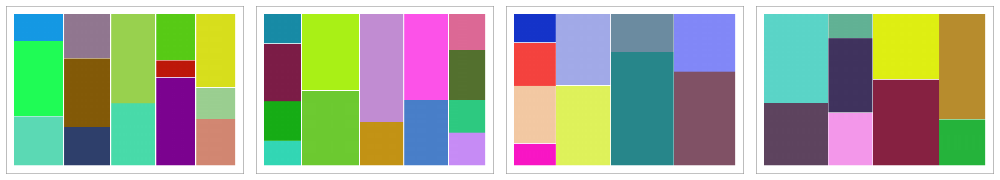
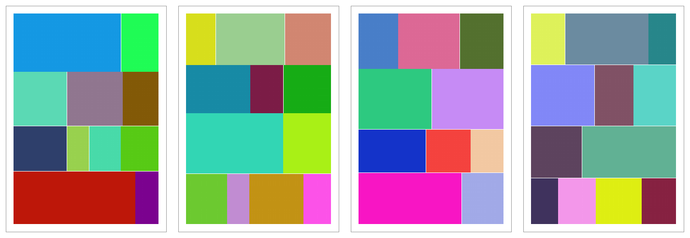
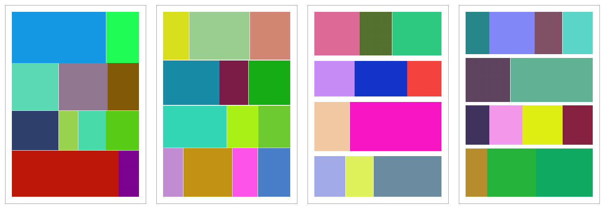
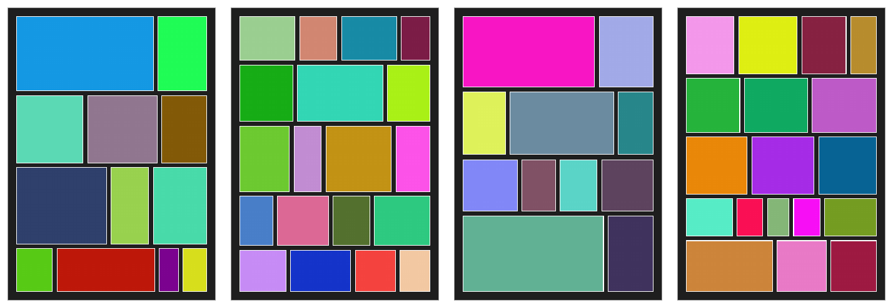

# Photo Collage Maker

A Python script that turns every photo in a folder (and its subfolders) into a
multi-page PDF collage, ready to print.

Photos are arranged in justified rows or columns that fill each page edge to
edge. The script decides how many photos go in each row and how many rows go
on each page so that as little paper as possible is left empty, and the photos
are never stretched or distorted.



## Features

- **Finds photos recursively:** JPEG, PNG, WebP and TIFF out of the box, plus
  HEIC/HEIF and camera RAW (DNG, CR2, CR3, NEF, ARW, ORF, RW2, RAF, ...) when
  the optional libraries are installed.
- **Rows or columns:** all photos in a row share the same height (or, in a
  column, the same width), and each row is stretched to the full printable
  width.
- **Space-filling layout:** the number of rows per page is a target that may
  change by ±1 (`--tolerance`) when that fills the pages better, which also
  avoids an almost empty last page.
- **Optional cropping:** `--max-crop` trims a few percent off photos so the
  rows fill the page completely.
- **Paper options:** ISO 216 A-series sizes (A0–A10) or a custom size in
  mm, portrait or landscape, with adjustable margins.
- **Styling:** image borders, spacing, background and border colours.
- **Compact, print-quality PDF:** photos are downscaled to a maximum DPI
  (default 300), EXIF rotation is respected, and transparent images are
  flattened onto the background colour.
- **One dependency:** only [Pillow](https://python-pillow.org/) is required;
  the script writes the PDF itself.

## Installation

You need Python 3 and Pillow:

```bash
pip install Pillow
```

Optional extras:

```bash
pip install pillow-heif   # HEIC / HEIF photos (iPhone)
pip install rawpy         # camera RAW files
```

Then download `photo-collage.py`. No further installation is needed.

## Usage

Go to the folder that contains your photos and run the script:

```bash
cd ~/Pictures/holiday-2026
python3 /path/to/photo-collage.py
```

The PDF is saved in that folder and named after it, for example
`holiday-2026_collage_2026-11-10-153012.pdf`.

Photos are placed in file-name order. Numbers sort naturally, so `img2` comes
before `img10`. Files that cannot be read are skipped with a warning.

### Examples

**Default:** about 3 rows per page on A4 portrait, 10 mm margin, 1 mm spacing:

```bash
python3 photo-collage.py
```


**Columns:** about 4 columns per page on landscape paper:

```bash
python3 photo-collage.py --columns 4 --paper-orientation landscape
```



**Cropping:** allow up to 10 % of each photo to be trimmed so the pages are
filled completely:

```bash
python3 photo-collage.py --rows 4 --max-crop 10
```



**Even rows:** a higher `--evenness` keeps the rows closer to the same height,
at the cost of some empty space between them:

```bash
python3 photo-collage.py --rows 4 --evenness 1
```



**Styled:** dark background, white borders and wider spacing:

```bash
python3 photo-collage.py --rows 4 --background-color "#1E1E1E" \
    --border-color "#FFFFFF" --image-border 1 --spacing 4 --paper-margin 8
```



## Options

| Option | Default | Description |
|---|---|---|
| `--rows [N]` | 3 | Arrange photos in rows, about N rows per page. This is the default placement method. |
| `--columns [N]` | 3 | Arrange photos in columns, about N columns per page. |
| `--tolerance K` | 1 | Each page may use between N−K and N+K rows/columns, whichever fills the pages best. `0` = exactly N. |
| `--max-crop PCT` | 0 | Allow cropping up to PCT % (0–50) of each photo so rows/columns fill the pages completely. `0` = never crop. |
| `--evenness W` | 0.15 | How strongly rows/columns are kept at similar heights (widths) versus filling the pages. Higher = more even, more empty space. `0` = fill as much as possible. |
| `--paper-size SIZE` | A4 | ISO 216 A-series size, `A0` to `A10`. |
| `--paper-size-x MM` | – | Custom paper width in mm (0–1000). Overrides `--paper-size`. |
| `--paper-size-y MM` | – | Custom paper height in mm (0–1000). Overrides `--paper-size`. |
| `--paper-orientation` | portrait | `portrait` or `landscape`. With a custom size it is only applied if given explicitly. |
| `--paper-margin MM` | 10 | Margin around the page in mm. |
| `--image-border MM` | 0 | Border around each photo in mm. |
| `--spacing MM` | 1 | Space between photos in the same row (column), and the minimum space between neighbouring rows (columns), in mm. |
| `--image-dpi DPI` | 300 | Maximum resolution of the photos in the PDF. Lower values give smaller files. |
| `--background-color HEX` | `#FFFFFF` | Page background colour. |
| `--border-color HEX` | `#000000` | Image border colour. |

Run `python3 photo-collage.py --help` for the full help text.

## How the layout works

1. **Rows are justified.** The photos in a row are scaled to the same height
   so that, together with borders and spacing, the row exactly fills the
   printable width. Columns work the same way, turned 90°.
2. **Rows are placed on pages.** The first row touches the top margin and the
   last row the bottom margin. Any leftover height is shared equally between
   the rows, which are always at least `--spacing` apart.
3. **The split is optimised.** A dynamic-programming search tries different
   ways of splitting the photo sequence into rows and pages. It picks the one
   with the least empty paper, balanced against keeping row heights even
   (`--evenness`). The photo order is always kept.
4. **The last row is kept in proportion.** If stretching the very last row
   would make it much taller than the others, it keeps the normal row height
   and starts at the left edge (top edge for columns) instead.
5. **Cropping is optional.** With `--max-crop`, all rows on a page are scaled
   together to fill the page exactly. Taller rows are trimmed at the sides,
   shorter ones at the top and bottom, never more than the given percentage.

Even 1,000+ photos are laid out in a few seconds; most of the run time is
spent loading and compressing the photos.

## Test photos

The `test-photos` folder holds 100 plain-coloured images of different sizes
and aspect ratios. The example images above were made from them. To try the
script:

```bash
cd test-photos
python3 ../photo-collage.py
```
